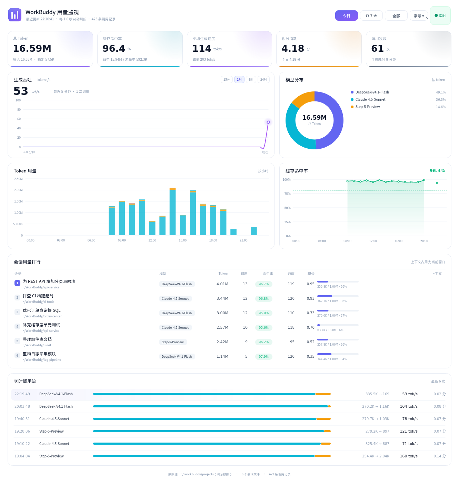
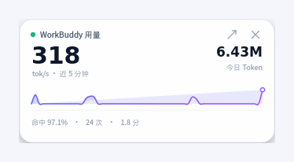

# Linux 端 · WorkBuddy 用量监视

简体中文 | [English](README.en.md)


> **适用平台**：Linux 桌面（x86_64 / ARM64）。已在银河麒麟、统信 UOS 等国产系统与兆芯平台上验证。
> 不依赖 Chromium / Electron——即使浏览器内核无法启动，面板也能正常显示。

一个本地运行的 WorkBuddy 用量面板：实时查看 **Token 消耗、生成吞吐、缓存命中率**，
附带积分统计与会话排行。数据全程只读留在本机，不联网、不上传。



## 功能

- **Linux 原生**：PyQt5 + QPainter 手绘，不依赖浏览器内核，国产化环境可直接用
- **零第三方依赖**（除 PyQt5）：采集与聚合只用 Python 标准库
- **两种界面**：原生窗口（默认）与 Web 面板（`--web`），共用同一层聚合逻辑
- **按模型查看与全屏联动**：支持按模型拆分 Token 用量与积分消耗，环形图支持一键切换「按 Token」与「按积分」；顶部支持指定模型全屏联动过滤；单模型视图下饼图自适应展示其内部构成（缓存命中/未命中/输出），并在右侧独立给出三种成分的单价估算（分/M Token）及综合单价
- **模型用量与积分排行榜**：表格区域支持双 Tab 切换，一览所有模型的 Token 用量、输入/输出拆分、缓存命中率、调用频次、生成速度、积分消耗及份额占比
- **多跨度时间查询与自定义范围**：支持「今日 / 昨日 / 近 7 天 / 近 30 天 / 全部」多档快捷预设，并提供日历弹窗自由选定起止日期；图表自适应按小时（≤40h）或按天（>40h）分桶
- **增量解析**：只读会话文件新增的字节，扫描频率跟随刷新设置，万级记录不卡
- **字号四档可调**：小 / 标准 / 大 / 特大，跟随系统 DPI 并记住选择
- **吞吐时间窗可切换**：15 分钟 / 1 小时 / 6 小时 / 24 小时，自动切换分桶粒度
- **刷新间隔可调**：0.1 秒（极速）/ 0.3 / 0.8 / 1.6 / 3 秒，高频档位走快照缓存，单次开销仍在毫秒级
- **悬浮小窗**：一键缩成置顶小卡片，只留关键指标，可拖动、双击还原
- **可导出快照**：一条命令生成单文件 HTML，发给别人不用装环境

## 安装

### 方式一：deb 包（推荐）

到 [Releases](https://github.com/The-garden-of-sinner/workbuddy-token-monitor/releases) 下载最新的
`workbuddy-token-monitor_<版本>_all.deb`：

```bash
sudo dpkg -i workbuddy-token-monitor_1.1.0_all.deb
sudo apt -f install          # 若提示缺少依赖
```

装好后从应用菜单打开「WorkBuddy 用量监视」，或终端执行 `workbuddy-token-monitor`。
卸载：`sudo apt remove workbuddy-token-monitor`。

### 方式二：源码运行

依赖 Python 3.8+ 与 PyQt5：

```bash
# Debian / Ubuntu / 银河麒麟 / 统信 UOS
sudo apt install python3 python3-pyqt5

# Arch / Manjaro
sudo pacman -S python python-pyqt5
```

```bash
git clone git@github.com:The-garden-of-sinner/workbuddy-token-monitor.git
cd workbuddy-token-monitor

./run.sh          # 打开原生窗口
./install.sh      # 安装桌面快捷方式 + 应用菜单项
```

缺少 PyQt5 时启动器会自动退回 `--web` 模式，不会直接报错退出。

## 使用

| 命令 | 作用 |
| --- | --- |
| `./run.sh` | 打开原生桌面窗口（默认） |
| `./run.sh --web` | 启动本地服务并打开 `http://127.0.0.1:8791` |
| `./stop.sh` | 停止 `--web` 模式的后台服务 |
| `./install.sh` | 安装桌面快捷方式与应用菜单项 |
| `./install.sh --uninstall` | 卸载桌面入口 |

## 界面

| 区域 | 说明 |
| --- | --- |
| 五张 KPI 卡 | 总 Token、缓存命中率、平均生成速度、积分消耗、调用次数（跟随模型与时间联动） |
| 生成吞吐 | 15 分钟 ~ 24 小时的 tokens/s 曲线（右上角切换），大字为最近 5 分钟加权平均 |
| 模型分布 / 构成 | 默认按模型拆分 Token 或积分占比（右上角切换）；选定单模型后展示其内部缓存/未命中/输出构成及各成分单价估算（分/M Token）与综合单价 |
| Token 用量 | 按小时 / 按天堆叠柱：缓存命中、未命中、输出（自动根据选定时长切分粒度） |
| 缓存命中率 | 按时间桶的命中率折线，80% 参考线 |
| 会话与模型排行 | 双 Tab 自由切换「会话用量排行」与「模型用量与积分明细」 |
| 实时调用流 | 最新 6 次调用，含输入/输出、实测速度与积分 |
| 悬浮小窗 | 顶部「悬浮」按钮缩成 326×158 的置顶卡片：最近一次调用的速度、今日 Token、迷你吞吐曲线、命中率与积分 |

顶部时间栏可切换「今日 / 昨日 / 近 7 天 / 近 30 天 / 全部 / 自定义 ▾」，并可通过「模型: 全部 ▾」进行全屏单模型指标联动。图表均支持鼠标悬停查看明细。



悬浮窗始终置顶，拖动可移动，双击或点右上角箭头回到完整面板，`×` 直接退出。

右上角「刷新」可切换刷新间隔。选 0.1 秒时，采集每 100 ms 扫一次新增字节（约 1.7 ms），
聚合结果命中缓存（约 0.04 ms），界面重绘则限流到每 200 ms 一次，CPU 占用约 2%。
字号与吞吐时间窗目前只在原生窗口提供，Web 版固定近 60 分钟、跟随浏览器缩放。

## 数据来源

全部只读，不修改任何 WorkBuddy 文件：

| 路径 | 内容 |
| --- | --- |
| `~/.workbuddy/projects/**/*.jsonl` | 每次模型调用的 `providerData.rawUsage`：`prompt_tokens`、`completion_tokens`、`prompt_cache_hit_tokens`、`credit`，以及毫秒时间戳 |
| `~/.workbuddy/workbuddy.db` | `sessions`（会话标题、模型、上下文窗口）、`session_usage`（当前上下文占用） |

两者都以只读方式打开；数据库不可用时自动降级，只显示 jsonl 里的信息。

### 指标口径

- **Token 总量** = 输入 tokens + 输出 tokens。输入已包含缓存命中的部分。
- **缓存命中率** = 缓存命中 tokens ÷ 输入 tokens。WorkBuddy 的 `prompt_tokens`
  是完整上下文长度，因此该比例反映"上下文中有多少可直接复用"。
- **生成速度** = 输出 tokens ÷ 单次生成耗时。耗时以"上一条工具结果 / 用户消息"
  到"本轮调用产出"为区间，包含首 token 延迟，因此短请求数值会偏低；
  KPI 的平均值按耗时加权，不是简单平均。
- **积分** = 记录中 `rawUsage.credit` 的累加，仅统计本地有记录的部分。

## 桌面端为什么不用浏览器内核

项目**同时提供 Web 版**（`web/` 目录，原生 Canvas 实现），它只是可选的查看方式。
桌面窗口走的是 Qt 原生绘制，原因有三：

- 在兆芯等平台上，Chromium / Firefox / Electron 启动即崩溃（SIGTRAP），
  `chrome --app` 这类"网页套壳"方案直接失效；
- 这类环境恰恰是国产化替代的主战场，工具打不开等于没有；
- Qt 是原生 C++ 绘制，不依赖 GPU 与浏览器沙箱，兼容性更好。

代价是图表要手写（`QPainter`）。所以两套界面共用 `server.py` 的聚合结果，
保证指标口径完全一致。

## 文件结构

```
workbuddy-token-monitor/
├── qt_app.py           桌面面板（PyQt5，QPainter 手绘图表）
├── server.py           数据采集与聚合（标准库）+ 可选 HTTP 服务
├── demo_data.py        演示数据（截图与文档示例使用，不读磁盘）
├── web/                Web 面板（原生 Canvas，无 CDN）
│   ├── index.html
│   ├── style.css
│   └── app.js
├── run.sh              启动器（默认原生窗口，--web 走浏览器）
├── stop.sh             停止 --web 模式的后台服务
├── install.sh          安装 / 卸载桌面入口
├── export_preview.py   导出单文件静态快照
├── preview.html        演示快照（可直接用浏览器打开）
├── make_icon.py        重新生成图标
├── build_deb.sh        构建 .deb 安装包
├── CHANGELOG.md        版本记录
├── screenshot.png      面板截图（演示数据）
├── screenshot-mini.png 悬浮窗截图
├── README.en.md        English README
└── LICENSE             MIT
```

## 自定义

```bash
WB_MONITOR_PORT=9000 ./run.sh --web            # 换端口
WB_HOME=/path/to/.workbuddy ./run.sh           # 指向其他数据目录
python3 qt_app.py --demo                       # 用演示数据打开
python3 qt_app.py --model DeepSeek-V4.1-Flash  # 启动时联动过滤指定模型
python3 qt_app.py --range 7d                   # 启动时指定时间范围（today/yesterday/7d/30d/all/custom）
python3 qt_app.py --shot out.png --range all   # 离屏渲染截图
python3 qt_app.py --shot-mini mini.png         # 只渲染悬浮窗
./build_deb.sh                                 # 打包到 dist/
```

界面偏好写在 `.runtime/ui.json`（字号、刷新间隔），删掉即恢复默认。

## 常见问题

**字太小 / 太大？** 右上角「字号」可切四档，选择会记住。默认跟随系统 DPI
（144 dpi 下自动按 1.5 倍渲染），觉得还小就选「大」或「特大」。

**双击没反应？** 确认 `.desktop` 有可执行权限（`install.sh` 已设置），
部分桌面环境首次还需右键 →「允许启动」。错误日志见 `.runtime/qt.log`。

**提示缺少 PyQt5？** 启动器会自动退回 `--web` 模式；也可安装
`python3-pyqt5` 后重试。

**数据是空的？** 确认 `~/.workbuddy/projects` 下有 `.jsonl` 会话记录，
且当前用户有读权限。

**占资源吗？** 窗口关闭后进程退出；后台仅 `--web` 模式常驻（约 30 MB）。

## 开发

```bash
python3 qt_app.py --demo                      # 用演示数据打开，不读本地记录
python3 qt_app.py --shot out.png --range all  # 离屏渲染截图
python3 export_preview.py demo.html --demo    # 导出单文件快照
```

演示数据在 `demo_data.py`，会话名与数值均为虚构，用于截图和文档，不接触真实数据。

## 版本

当前版本见 [CHANGELOG.md](CHANGELOG.md)。发版流程：

```bash
./build_deb.sh 1.0.1        # 打包
git tag v1.0.1 && git push origin v1.0.1
./release.sh 1.0.1          # 建 Release 并上传 deb
```

`release.sh` 从 `~/.config/github/token` 读取 GitHub token（也可用 `GH_TOKEN` 环境变量），
首次使用先跑一次 `./setup_token.sh` 交互录入，token 不会回显、也不会进 shell 历史。

## 许可证

[MIT](LICENSE)
